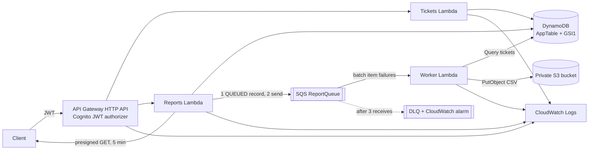

# Support Tickets API (Python + AWS)

Authenticated users manage support tickets and request CSV reports of them, generated asynchronously.
API Gateway (HTTP API, Cognito JWT authorizer) -> Lambda -> DynamoDB; reports go through SQS -> worker Lambda -> private S3.
Infrastructure: AWS SAM (`template.yaml`). Runtime: Python 3.12 (x86_64). Dependencies pinned in `src/requirements.txt` / `requirements-dev.txt`.

> **Status:** deployed to AWS (us-east-1) with SAM. 52 automated tests run locally against moto; the live end-to-end test (`pytest -m live`) runs against the deployed stack. Limitations below.

## Architecture



Code layout (HTTP / business logic / AWS access are separate):

| Layer | Path |
|---|---|
| HTTP (parse, status codes, error body) | `src/handlers/`, `src/common/http.py` |
| Business logic (validation, rules, CSV, idempotency) | `src/services/` |
| AWS / data access (DynamoDB, SQS, S3, key schema) | `src/repositories/`, `src/common/clients.py` |

Details: [DynamoDB keys & access patterns](docs/DYNAMODB.md) - [Reliability, failures, recovery](docs/RELIABILITY.md) - [OpenAPI](docs/openapi.yaml) - [Postman collection](docs/postman_collection.json)

## Local development (no AWS account needed)

`local_server.py` runs the real Lambda handlers behind a plain HTTP server on top of moto (DynamoDB, SQS, S3), with the report worker running in the background. **Dev only**: it skips JWT validation and takes the user id from an `X-User-Id` header, so it must never be deployed (it is outside `src/` and not packaged).

```bash
python3 -m venv .venv && . .venv/bin/activate
pip install -r requirements-dev.txt
python local_server.py                      # http://localhost:8080  (--port 9090 to change)
curl -H "X-User-Id: alice" http://localhost:8080/tickets
```

## Deploy / clean up

Prereqs: AWS CLI configured (free-tier account), SAM CLI, Python 3.12.

```bash
sam validate --lint
sam build
sam deploy --guided --stack-name support-tickets      # first time (saves samconfig.toml locally, git-ignored); later: sam deploy
# stack outputs: ApiUrl, UserPoolId, UserPoolClientId, ReportQueueUrl, ReportDlqUrl, ReportBucketName, TableName
# cleanup (empty the bucket first, otherwise stack deletion fails)
BUCKET=$(aws cloudformation describe-stacks --stack-name support-tickets --query "Stacks[0].Outputs[?OutputKey=='ReportBucketName'].OutputValue" --output text)
aws s3 rm "s3://$BUCKET" --recursive
sam delete --stack-name support-tickets
```

Configuration is via environment variables set in `template.yaml` (`TABLE_NAME`, `REPORT_QUEUE_URL`, `REPORT_BUCKET`, `PRESIGN_TTL_SECONDS`, `MAX_RECEIVE_COUNT`). No secrets exist in the repo; `samconfig.toml`, `.env` and `*.token` are git-ignored.

## Getting a test token (for reviewers)

```bash
eval "$(scripts/get_token.sh support-tickets reviewer@example.com)"   # exports ID_TOKEN and API_URL
curl -H "Authorization: Bearer $ID_TOKEN" "$API_URL/tickets"
```
The script creates a Cognito user (admin API, no email sent), sets a throw-away password and signs in with `USER_PASSWORD_AUTH`. Use the **ID token**. Run it with a second email to get a second user for isolation checks. Tokens are not written to disk or logs.

## Sample requests and responses

```bash
curl -s -X POST "$API_URL/tickets" -H "Authorization: Bearer $ID_TOKEN" -H 'Content-Type: application/json' \
  -d '{"title":"Printer broken","description":"Paper jam","priority":"HIGH"}'
```
```json
201 {"ticketId":"019a0c4e1f2b8d3c5a7e90b1","title":"Printer broken","description":"Paper jam","priority":"HIGH","status":"OPEN","createdBy":"4f2c...-sub","createdAt":"2026-10-10T14:01:02.123Z","updatedAt":"2026-10-10T14:01:02.123Z"}
```
```bash
curl -s "$API_URL/tickets?status=OPEN&limit=2" -H "Authorization: Bearer $ID_TOKEN"
# 200 {"items":[{...},{...}],"nextToken":"eyJwayI6..."}   -> pass ?nextToken=... for the next page
curl -s -X PATCH "$API_URL/tickets/<id>" -H "Authorization: Bearer $ID_TOKEN" -H 'Content-Type: application/json' -d '{"status":"IN_PROGRESS"}'
curl -s -X DELETE "$API_URL/tickets/<id>" -H "Authorization: Bearer $ID_TOKEN"   # 204
curl -s -X POST "$API_URL/reports" -H "Authorization: Bearer $ID_TOKEN" -H 'Content-Type: application/json' -d '{"status":"OPEN"}'
# 202 {"reportId":"5bfab2f6-...","status":"QUEUED","statusFilter":"OPEN","createdAt":"...","updatedAt":"..."}
curl -s "$API_URL/reports/<reportId>" -H "Authorization: Bearer $ID_TOKEN"
# 200 {"reportId":"...","status":"COMPLETED","ticketCount":3,"completedAt":"...","downloadUrl":"https://<bucket>.s3.<region>.amazonaws.com/reports/...&X-Amz-Expires=300&...","downloadUrlExpiresInSeconds":300}
```
Error shape (all errors): 
```json
404 {"error":{"code":"NOT_FOUND","message":"Ticket abc not found","requestId":"Xk3d9gF1IAMEJdg="}}
```
`400 VALIDATION_ERROR`, `401` (from the authorizer), `404 NOT_FOUND` (also for other users' resources), `503 SERVICE_UNAVAILABLE`, `500 INTERNAL_ERROR` (no internals leaked). The `requestId` equals API Gateway's request id and the `X-Request-Id` header.

## Tests

```bash
python3 -m venv .venv && . .venv/bin/activate
pip install -r requirements-dev.txt
pytest                      # 52 unit/integration tests + in-process end-to-end test (moto, no AWS needed)

# End-to-end against the deployed stack (ticket -> report -> status poll -> CSV download):
eval "$(scripts/get_token.sh support-tickets)"
pytest -m live tests/test_e2e.py
```
Coverage map: ticket create/update/invalid input/404/pagination/status filter/cross-user access (`tests/test_tickets.py`); cross-user report access, report generation, duplicate delivery, worker failure + retry + DLQ + recovery, enqueue failure, stale `QUEUED` recovery, CSV-injection, log structure (`tests/test_reports.py`); full flow (`tests/test_e2e.py`).

## Security and IAM

* JWT validated by API Gateway (issuer + audience = app client). Identity = `sub` claim only; `createdBy` in a request body is rejected with 400. Every DynamoDB key embeds the caller's `sub`, and S3 keys embed it too, so cross-user access yields 404.
* Least privilege, one role per function: Tickets = DynamoDB CRUD + Query on the table and GSI1 only; Reports = Put/Get/Update item, `sqs:SendMessage` on the one queue, `s3:GetObject` on `reports/*` (required for presigning); Worker = Get/Update/Query, `s3:PutObject` on `reports/*`. SQS receive/delete for the worker comes from the SAM SQS event policy.
* S3 bucket: all public access blocked, SSE, TLS-only policy, 30-day expiry. Downloads only via 5-minute presigned URLs (the presigned URL also expires when the Lambda role's session credentials do).
* Logs are JSON with `requestId` / `reportId` / `messageId`; no request bodies, headers or tokens are logged. CSV cells starting with `= + - @` are prefixed with `'` to prevent spreadsheet formula injection.

## Key design decisions and trade-offs

* **Single-table DynamoDB with user-scoped keys** - isolation and cheap Query-based listing/filtering; trade-off: only the planned access patterns are cheap (e.g. no search by title / priority).
* **Idempotency by `reportId` + deterministic S3 key + guarded status writes** instead of a dedupe table or FIFO queue - simpler, works with standard SQS.
* **Record first, then publish** - simplest correct ordering; the gap is handled by FAILED-on-error plus a stale-report requeue tool (see RELIABILITY.md). A DynamoDB-Streams outbox would close it fully at higher complexity.
* **Report = processing-time snapshot** (documented in RELIABILITY.md).
* **Hand-written validation** rather than pydantic: no extra packaging weight, rules are small.
* **HTTP API (v2) rather than REST API**: cheaper, native JWT authorizer.

## Known limitations / incomplete

* moto (used by the automated tests) does not model IAM, the Cognito authorizer or real SQS redrive timing; those are only exercised on the deployed stack. The redrive policy is tested at queue level and the worker's retry behaviour by invoking it with `ApproximateReceiveCount`.
* The CSV is built in memory (fine for thousands of tickets; very large users need S3 multipart/streaming).
* No client idempotency key on `POST /reports` / `POST /tickets` (retries create duplicates).
* Stale-report recovery is a manual script, not a scheduled Lambda; no `GET /reports` list endpoint; no CloudWatch alarms beyond the DLQ one.
* Report downloads after the 30-day lifecycle expiry return S3 `NoSuchKey` while the record still says COMPLETED.
* Pagination can return a final empty page (DynamoDB semantics); sorting is by creation time only.
* No rate limiting per user (only a stage-wide throttle), no CORS (no frontend), no custom domain / WAF.

## Improvements with more time
Transactional outbox via DynamoDB Streams or EventBridge Pipes; scheduled reconciler Lambda; Idempotency-Key header; per-user rate limits; streaming CSV; X-Ray/Powertools metrics; CI pipeline (lint, tests, `sam validate`, cfn-lint, pip-audit); least-privilege deploy role; separate table for reports if retention differs.

## AI and external code disclosure

* **AI tools:** Anthropic's Claude (Claude Code) was used to draft the code, tests, SAM template and documentation. I reviewed, deployed and tested the result and can explain and modify every part of it. *(Edit this sentence so it states exactly how you used it.)*
* **External libraries:** boto3 (runtime and tests); dev/test only: moto, pytest, requests. No third-party code was copied beyond these dependencies.
